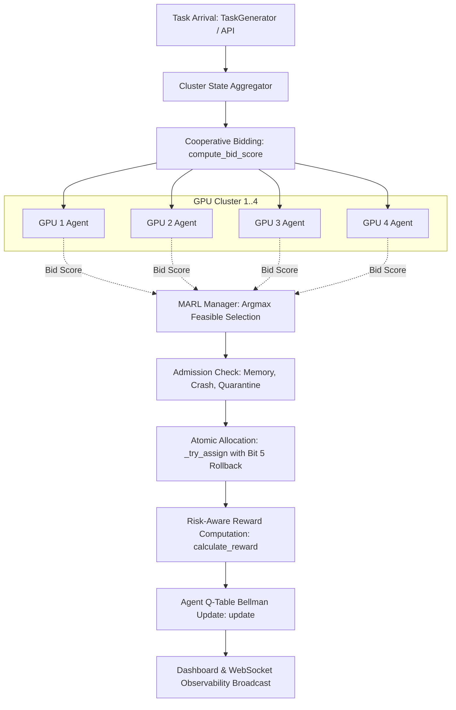

# BIT 6: Risk-Aware RL + Multi-Agent Reinforcement Learning (MARL)
## SmartGPU Allocator: Cooperative Risk-Aware MARL Architecture

---

### 1. Architectural Overview & Data Flow

Bit 6 implements an end-to-end **Risk-Aware Cooperative Multi-Agent Reinforcement Learning** framework for dynamic multi-GPU scheduling in AETHERGRID. Rather than scheduling tasks purely based on instantaneous queue lengths or memory availability, each GPU is paired with a dedicated MARL Agent that bids on incoming tasks based on:
1. **Learned Q-Values**: Capturing long-term policy value from tabular state-action histories.
2. **Performance Headroom**: Local memory headroom, task queue length, operating temperature, and fragmentation.
3. **GPU Health & Empirical Reliability**: Dynamic health score from the Authoritative Risk Engine (`RiskEngine`) and empirical failure rate.
4. **Estimated Expected Failure Cost (EFC)**: Proactive pre-placement penalty combining failure probability, task severity, and recovery overhead.



---

### 2. Risk-Aware State Representation

To ensure stability, determinism, and prevent state explosion in tabular Q-learning, the system extracts a finite, repeatable **16-element discrete state tuple** `S in Z_16`:

| Dim | Name | Bucketing Boundaries & Values | Physical Significance |
|---|---|---|---|
| 0 | `mem_bin` | `0: <50%`, `1: 50-80%`, `2: >80%` | Local GPU memory pressure |
| 1 | `load_bin` | `0: idle (0)`, `1: low (1-2)`, `2: high (>=3)` | Local task load (running + queued) |
| 2 | `temp_bin` | `0: <=65°C`, `1: 65-80°C`, `2: >80°C` | Thermal condition relative to 85°C crash |
| 3 | `risk_bin` | `0: <=0.25`, `1: 0.25-0.50`, `2: 0.50-0.75`, `3: >0.75` | Dynamic risk score from RiskEngine |
| 4 | `fail_bin` | `0: <=5%`, `1: 5-20%`, `2: >20%` | Historical empirical failure rate |
| 5 | `status_bin`| `0: Healthy`, `1: Cooldown`, `2: Crashed/Quarantined` | Operational status of candidate GPU |
| 6 | `frag_bin` | `0: <10%`, `1: 10-30%`, `2: >30%` | Memory fragmentation percentage |
| 7 | `preempt_bin`| `0: 0`, `1: 1-2`, `2: >2` | Historical task preemptions |
| 8 | `task_mem_bin`| `0: <=2GB`, `1: 2-4GB`, `2: >4GB` | Incoming task VRAM demand |
| 9 | `task_time_bin`| `0: <=2 steps`, `1: 3-5 steps`, `2: >5 steps` | Incoming task execution duration |
| 10 | `task_impact_bin`| `0: Low (<0.4)`, `1: Med (0.4-0.7)`, `2: High (>0.7)` | Workload severity & failure impact |
| 11 | `efc_bin` | `0: Low (<0.5)`, `1: Med (0.5-2.0)`, `2: High (>2.0)` | Estimated expected failure cost |
| 12 | `cluster_util_bin`| `0: <40%`, `1: 40-75%`, `2: >75%` | Cluster-wide average utilization |
| 13 | `idle_gpu_bin`| `0: 0`, `1: 1-2`, `2: >2` | Number of idle GPUs in cluster |
| 14 | `overloaded_gpu_bin`| `0: 0`, `1: 1-2`, `2: >2` | Number of overloaded GPUs (>=4 tasks) |
| 15 | `cluster_avail_mem_bin`| `0: <8GB`, `1: 8-16GB`, `2: >16GB` | Total cluster-wide free VRAM |

**Safe Fallback**: If a GPU lacks an attached risk engine, `risk_bin`, `fail_bin`, and `efc_bin` safely default to `0`, preventing runtime errors while preserving determinism.

#### 2.1 Seven-Dimensional Core Abstract State (`_get_core_state`)
To facilitate rapid cross-state generalization across transient cluster variations (such as time of day, idle count, and cluster memory) while preserving local GPU physical safety and task requirements, `MARLAgent` extracts a compact **7-dimensional Core State** used in `core_q_table`:

$$\mathcal{S}_{\text{7D}} = \left(s_0, s_1, s_2, s_3, s_5, s_8, s_{11}\right) = \left(\text{mem\_bin}, \text{load\_bin}, \text{temp\_bin}, \text{risk\_bin}, \text{status\_bin}, \text{task\_mem\_bin}, \text{efc\_bin}\right)$$

| Index in Full State | Feature Name | Discrete Cardinality | Physical Meaning |
|---|---|---|---|
| `state[0]` | `mem_bin` | 3 values: `{0, 1, 2}` | Local GPU VRAM pressure (<50%, 50-80%, >80%) |
| `state[1]` | `load_bin` | 3 values: `{0, 1, 2}` | Running + queued tasks (0, 1-2, >=3) |
| `state[2]` | `temp_bin` | 3 values: `{0, 1, 2}` | Core temperature (<=65°C, 65-80°C, >80°C) |
| `state[3]` | `risk_bin` | 4 values: `{0, 1, 2, 3}` | Dynamic risk score (<=0.25, 0.25-0.50, 0.50-0.75, >0.75) |
| `state[5]` | `status_bin` | 3 values: `{0, 1, 2}` | Operational state (0: Healthy, 1: Cooldown, 2: Crashed/Quarantine) |
| `state[8]` | `task_mem_bin`| 3 values: `{0, 1, 2}` | Incoming task VRAM demand (<=2GB, 2-4GB, >4GB) |
| `state[11]` | `efc_bin` | 3 values: `{0, 1, 2}` | Expected failure cost (<0.5, 0.5-2.0, >2.0) |

Total discrete core state cardinality: $3 \times 3 \times 3 \times 4 \times 3 \times 3 \times 3 = 2,916$ states.
When an exact 16-tuple state has not yet been encountered in `q_table`, the agent falls back to `core_q_table[core_state]`, enabling policy transfer across similar tasks.

---

### 3. Expected Failure Cost (EFC) Model

Prior to task placement, the MARL Manager computes the expected failure cost for each feasible candidate GPU:

$$\text{EFC} = P(\text{failure}) \times I(\text{task}) \times C(\text{recovery})$$

Where:
1. **Estimated Failure Probability $P(\text{failure})$**:
   $$P(\text{failure}) = 0.70 \times \text{risk\_score} + 0.30 \times \min\left(1.0, \frac{\text{failure\_rate}}{100.0}\right)$$
   *(Fallback if RiskEngine is unavailable: $0.50 \times \text{temp\_norm} + 0.50 \times \text{mem\_norm}$)*

2. **Estimated Failure Impact $I(\text{task})$**:
   $$I(\text{task}) = 0.60 \times M_{\text{severity}} + 0.40 \times \left(\frac{M_{\text{req}}}{8.0} + \frac{T_{\text{exec}}}{20.0}\right) \times 0.50$$
   Severity Multipliers $M_{\text{severity}}$: `LOW: 0.25`, `MEDIUM: 0.50`, `HIGH: 0.75`, `VERY HIGH / EXTREME: 1.00`.

3. **Estimated Recovery Cost $C(\text{recovery})$**:
   $$C(\text{recovery}) = \max(1.0, 0.30 \times T_{\text{exec}} + 0.10 \times M_{\text{req}}) + \text{crash\_cooldown\_timer}$$

---

### 4. Risk-Aware Cooperative Bidding & Numerical Scales

For every task arrival, candidate GPUs calculate their bid score via `compute_bid_score`:

```python
bid_score = (q_value * 0.50) + perf_score - risk_penalty - efc_penalty
```

- **Physical Feasibility Filter**: If `gpu.crashed`, `gpu.is_in_cooldown()`, `gpu.is_quarantined()`, or `gpu.current_memory + task.memory_required > gpu.memory_capacity`, the bid is strictly $-\infty$.
- **Performance Subscore**:
  $$\text{perf\_score} = 0.10 \times \text{mem\_headroom} + 0.08 \times (1 - \text{queue\_pen}) + 0.05 \times (1 - \text{temp\_pen}) + 0.04 \times (1 - \text{running\_pen}) + 0.03 \times (1 - \text{frag\_pen})$$
  *Numerical Scale*: $\text{perf\_score} \in [0.00, 0.30]$.
- **Risk Penalties**:
  $$\text{risk\_penalty} = 0.25 \times \text{risk\_score} \quad (\in [0.00, 0.25])$$
  $$\text{efc\_penalty} = 0.20 \times \min\left(1.0, \frac{\text{EFC}}{4.0}\right) \quad (\in [0.00, 0.20])$$
- **Net Heuristic Range**:
  $$\text{heuristic\_score} = \text{perf\_score} - \text{risk\_penalty} - \text{efc\_penalty} \in [-0.45, +0.30]$$
- **Q-Value Term Scale ($0.50 \times Q$)**:
  The Q-value $Q(s, a)$ is learned from rewards bounded in $[-20.0, 12.0]$. Under typical training, non-zero Q-values range around $[-2.0, +1.0]$, giving $0.50 \times Q \in [-1.0, +0.5]$. This numerical scale allows learned policy values to guide or override heuristic scores without drowning them out.

---

### 5. Configurable Risk-Aware Reward Function

The reward function balances throughput, reliability, and risk avoidance, centralized in `RiskAwareRewardConfig`:

$$R = R_{\text{base}} + B_{\text{comp}} - P_{\text{load}} - P_{\text{mem}} - P_{\text{temp}} - w_{\text{risk}} \times \text{risk\_score} - w_{\text{efc}} \times \min(3.0, \text{EFC}) - P_{\text{cooldown}} - P_{\text{quarantine}}$$

```python
@dataclass
class RiskAwareRewardConfig:
    base_success_reward: float = 4.0
    task_completion_bonus: float = 3.0
    weight_performance: float = 1.0
    weight_risk_penalty: float = 3.0
    weight_expected_failure_cost: float = 1.5
    weight_recovery_penalty: float = 1.0
    weight_constraint_violation: float = 5.0
    failure_penalty: float = 20.0
    min_reward: float = -20.0
    max_reward: float = 12.0
```

- **Failure Penalty**: On assignment failure or crash, returns exactly $-20.0$.
- **Bounded Range**: Rewards are strictly clamped within $[-20.0, 12.0]$ to stabilize Bellman updates and prevent divergence.

---

### 6. Experimental Validation & Benchmark Results

Evaluated across the 7 mandatory benchmark scenarios comparing `marl`, `least_loaded`, `round_robin`, and `fcfs` (15 active arrival steps + 10 post-arrival drain steps = 25 total steps, 3 independent seeds `[101, 102, 103]`):

| Scenario | Scheduler | Active Ep Compl (%) | Post-Drain Compl (%) | Completed Tasks | Failed Retries | Latency Score | Time-Avg Util (%) | Avg EFC | Cap Viol |
|---|---|---|---|---|---|---|---|---|---|
| **1. Normal Workload** | MARL | 49.4% ± 0.8% | 87.0% ± 4.6% | 43.3 ± 3.3 | 226.3 ± 45.1 | 75.00 ± 5.52 | 70.8% ± 3.9% | 0.047 ± 0.008 | 0 |
| | Least Loaded | 55.3% ± 3.4% | 90.2% ± 2.3% | 45.0 ± 3.3 | 205.0 ± 36.1 | 75.50 ± 7.08 | 71.7% ± 4.2% | 0.044 ± 0.013 | 0 |
| | Round Robin | 52.2% ± 3.2% | 87.7% ± 4.0% | 43.7 ± 2.5 | 214.7 ± 46.9 | 74.33 ± 5.44 | 71.8% ± 4.1% | 0.056 ± 0.004 | 0 |
| | FCFS | 54.8% ± 2.5% | 88.2% ± 3.8% | 44.0 ± 3.6 | 194.3 ± 46.6 | 77.17 ± 5.07 | 71.0% ± 3.5% | 0.044 ± 0.007 | 0 |
| **2. Elevated Risk (GPU 0)** | MARL | 46.9% ± 2.3% | 85.6% ± 3.8% | 42.7 ± 3.1 | 256.3 ± 49.9 | 76.00 ± 7.36 | 73.4% ± 3.9% | 0.115 ± 0.003 | 0 |
| | Least Loaded | 50.0% ± 0.0% | 82.9% ± 2.5% | 41.3 ± 2.9 | 241.7 ± 37.7 | 75.33 ± 6.25 | 72.6% ± 4.0% | 0.118 ± 0.013 | 0 |
| | Round Robin | 48.8% ± 1.7% | 82.9% ± 4.4% | 41.3 ± 3.3 | 260.0 ± 55.2 | 73.00 ± 4.14 | 72.2% ± 5.3% | 0.119 ± 0.003 | 0 |
| | FCFS | 52.1% ± 5.7% | 84.3% ± 3.1% | 42.0 ± 2.9 | 233.3 ± 51.6 | 76.17 ± 6.84 | 74.4% ± 3.7% | 0.136 ± 0.015 | 0 |
| **3. High Recovery Cost** | MARL | 52.5% ± 4.2% | 85.1% ± 4.4% | 42.3 ± 2.1 | 226.3 ± 30.7 | 75.50 ± 4.60 | 69.6% ± 4.1% | 0.075 ± 0.005 | 0 |
| | Least Loaded | 52.6% ± 0.7% | 83.8% ± 5.1% | 41.7 ± 2.4 | 228.3 ± 30.8 | 75.00 ± 4.08 | 69.6% ± 4.4% | 0.084 ± 0.008 | 0 |
| | Round Robin | 51.5% ± 2.4% | 86.4% ± 3.6% | 43.0 ± 2.4 | 239.7 ± 51.7 | 76.83 ± 5.95 | 68.8% ± 4.1% | 0.075 ± 0.006 | 0 |
| | FCFS | 52.8% ± 4.0% | 85.7% ± 3.8% | 42.7 ± 2.5 | 220.0 ± 41.1 | 76.33 ± 4.50 | 69.9% ± 3.6% | 0.076 ± 0.003 | 0 |
| **4. Dynamic Fault & Quaran.** | MARL | 46.1% ± 5.7% | 79.9% ± 2.0% | 40.0 ± 4.5 | 257.7 ± 42.1 | 70.67 ± 6.33 | 71.0% ± 3.6% | 0.087 ± 0.008 | 0 |
| | Least Loaded | 46.8% ± 3.8% | 79.8% ± 2.0% | 40.0 ± 4.9 | 251.7 ± 44.8 | 71.50 ± 8.26 | 72.8% ± 4.3% | 0.097 ± 0.015 | 0 |
| | Round Robin | 47.4% ± 4.8% | 81.2% ± 2.0% | 40.7 ± 4.9 | 255.7 ± 48.6 | 71.33 ± 7.41 | 72.5% ± 5.2% | 0.109 ± 0.009 | 0 |
| | FCFS | 51.2% ± 2.6% | 83.5% ± 4.4% | 41.7 ± 3.8 | 243.7 ± 29.8 | 74.33 ± 5.33 | 70.7% ± 5.4% | 0.115 ± 0.011 | 0 |
| **5. Mixed Tasks (Diverse)** | MARL | 21.5% ± 2.3% | 41.6% ± 4.0% | 43.3 ± 5.6 | 1228.3 ± 114.2 | 98.67 ± 27.62 | 76.6% ± 4.6% | 0.062 ± 0.012 | 0 |
| | Least Loaded | 23.7% ± 4.2% | 42.2% ± 7.1% | 44.0 ± 8.5 | 1196.0 ± 152.2 | 101.83 ± 37.14 | 76.9% ± 3.6% | 0.067 ± 0.014 | 0 |
| | Round Robin | 22.8% ± 3.4% | 42.9% ± 4.4% | 44.7 ± 6.0 | 1218.3 ± 124.5 | 95.83 ± 25.50 | 75.8% ± 3.8% | 0.057 ± 0.013 | 0 |
| | FCFS | 23.5% ± 3.1% | 42.0% ± 5.7% | 43.7 ± 6.6 | 1189.3 ± 130.6 | 107.67 ± 30.73 | 78.3% ± 2.6% | 0.052 ± 0.013 | 0 |
| **6. Heavy Burst Workload** | MARL | 34.7% ± 5.3% | 59.0% ± 9.8% | 51.3 ± 3.3 | 880.3 ± 382.1 | 100.83 ± 11.90 | 74.0% ± 3.6% | 0.045 ± 0.011 | 0 |
| | Least Loaded | 33.6% ± 5.8% | 57.9% ± 8.9% | 50.7 ± 5.4 | 882.7 ± 369.8 | 100.83 ± 18.30 | 74.1% ± 2.9% | 0.051 ± 0.008 | 0 |
| | Round Robin | 34.3% ± 7.8% | 56.0% ± 8.0% | 49.0 ± 4.5 | 904.3 ± 380.7 | 94.17 ± 12.43 | 73.9% ± 3.0% | 0.045 ± 0.012 | 0 |
| | FCFS | 36.2% ± 6.1% | 59.0% ± 8.4% | 51.7 ± 5.0 | 856.0 ± 357.4 | 108.67 ± 18.90 | 74.5% ± 2.0% | 0.043 ± 0.007 | 0 |
| **7. Concurrent Workload** | MARL | 95.8% ± 2.4% | 99.2% ± 1.2% | 39.7 ± 0.5 | 168.7 ± 34.6 | 123.67 ± 8.58 | 42.6% ± 3.9% | 0.022 ± 0.010 | 0 |
| | Least Loaded | 95.0% ± 2.0% | 98.3% ± 1.2% | 39.3 ± 0.5 | 147.0 ± 46.0 | 133.17 ± 15.93 | 46.5% ± 13.2% | 0.023 ± 0.006 | 0 |
| | Round Robin | 98.3% ± 1.2% | 99.2% ± 1.2% | 39.7 ± 0.5 | 116.3 ± 28.9 | 138.50 ± 8.15 | 30.3% ± 9.5% | 0.015 ± 0.003 | 0 |
| | FCFS | 95.0% ± 3.5% | 98.3% ± 2.4% | 39.3 ± 0.9 | 114.3 ± 25.7 | 143.17 ± 1.93 | 44.0% ± 18.3% | 0.014 ± 0.006 | 0 |

---

### 7. Verification & Commands

```powershell
# Run all automated tests (61 tests)
python -m pytest tests/ -v

# Run Bit 6 specific tests (23 tests across Suites A-F)
python -m pytest tests/test_bit6_risk_aware_marl.py -v

# Run Concurrency Locks stress suite (11 tests)
python -m pytest tests/test_concurrency_locks.py -v

# Run High-Contention Concurrency Stress Test CLI
python -u concurrency_stress_test.py --workers 4 --duration 1.5 --scheduler marl

# Run 7-Scenario Scientific Benchmark
python -u benchmark_risk_aware_marl.py --steps 15 --trials 3

# Run Full Feature Verification
$env:PYTHONUTF8=1; python verify_all_features.py

# Run Phase 4 Video Workload Execution Demo
$env:PYTHONUTF8=1; python phase4_execution_demo.py
```
