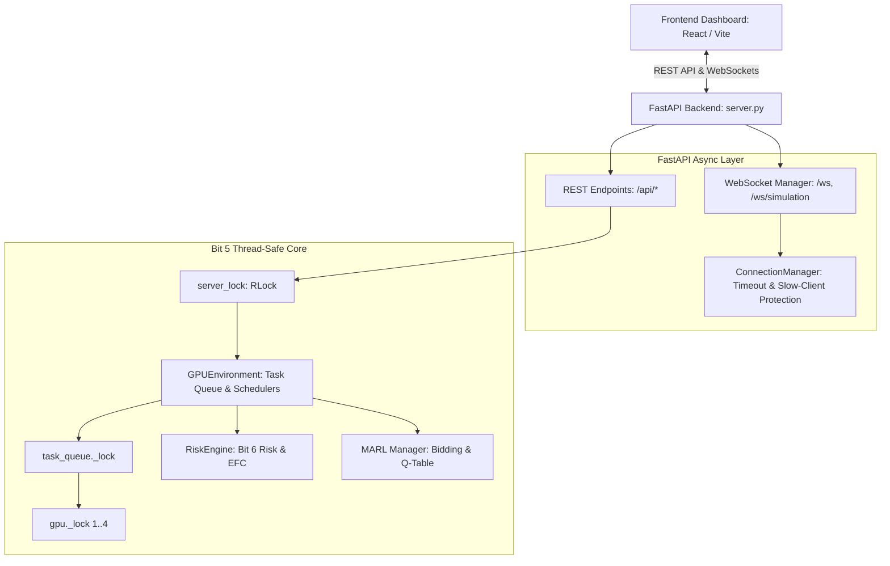

# BIT 7: Backend API + WebSocket Integration
## SmartGPU Allocator / AetherGrid — Real-Time Telemetry & Orchestration

---

### 1. Architectural Overview & Data Flow

Bit 7 integrates the existing backend, Bit 5 concurrency-safe locking mechanisms, Bit 6 risk-aware MARL scheduler, task lifecycle engine, and frontend dashboard through reliable REST APIs and real-time WebSocket updates.



#### Core Data Flow
1. **Task Submission**: Tasks arrive programmatically via `POST /api/tasks` or via media upload via `POST /analyze-video`.
2. **Admission & Capacity Guard**: Checks the strict 8.0 GB physical GPU capacity invariant. If exceeded, immediately returns HTTP 400 Bad Request.
3. **Risk-Aware MARL Bidding**: Evaluates candidate bid scores across all 4 GPUs factoring in learned Q-values, memory headroom, queue depth, risk score, and Expected Failure Cost (EFC).
4. **Assignment & Lock Hierarchy**: Acquires `task_queue._lock -> gpu._lock` without inversions, updates task lifecycle state atomically, updates MARL Q-table.
5. **Real-Time Notification**: Releases internal locks, then publishes typed events (`task.lifecycle`, `scheduler.decision`, `snapshot`) to all active WebSocket clients via `ConnectionManager`.
6. **Frontend State Merging**: The React dashboard merges incoming snapshots and lifecycle events by stable entity IDs without reloading the page.

---

### 2. REST API Endpoints & Response Schemas

All endpoints return JSON and use standard HTTP status codes.

#### A. System Overview
- **Endpoint**: `GET /api/status`
- **Description**: Returns live system snapshot derived from actual runtime state.
- **Example Response**:
```json
{
  "total_gpus": 4,
  "healthy_gpus": 4,
  "busy_gpus": 1,
  "idle_gpus": 3,
  "cooling_down_gpus": 0,
  "crashed_gpus": 0,
  "quarantined_gpus": 0,
  "total_submitted_tasks": 12,
  "queued_tasks": 0,
  "running_tasks": 1,
  "completed_tasks": 11,
  "failed_tasks": 0,
  "cancelled_tasks": 0,
  "scheduler_mode": "marl",
  "operational_status": "RUNNING",
  "timestamp": "2026-10-21T17:28:43.123456+00:00"
}
```

#### B. GPU Telemetry
- **Endpoint**: `GET /api/gpus`
- **Description**: Returns actual physical GPU telemetry and health states for all GPUs.
- **Example Response**:
```json
{
  "gpus": [
    {
      "gpu_id": 1,
      "total_vram_gb": 8.0,
      "allocated_vram_gb": 2.5,
      "available_vram_gb": 5.5,
      "utilization_pct": 31.2,
      "memory_usage_pct": 31.25,
      "queue_depth": 0,
      "running_tasks_count": 1,
      "temperature": 34.5,
      "health_status": "HEALTHY",
      "fragmentation_pct": 12.0,
      "crashed": false,
      "cooldown": false,
      "quarantined": false,
      "risk_score": 0.0821,
      "risk_category": "LOW",
      "expected_failure_cost": 0.0412,
      "active_task_ids": ["video_0001"],
      "completed_tasks": 3,
      "total_preemptions": 0
    }
  ],
  "timestamp": "2026-10-21T17:28:43.123456+00:00"
}
```

#### C. Task Lifecycle & Management
- **Endpoint**: `GET /api/tasks`
- **Query Parameters**:
  - `status` (*optional*): Filter by lifecycle state (`QUEUED`, `SCHEDULED`, `RUNNING`, `COMPLETED`, `FAILED`, `CANCELLED`).
  - `limit` (*default 50, max 200*): Number of tasks per page.
  - `offset` (*default 0*): Pagination offset.
- **Example Response**:
```json
{
  "total": 1,
  "limit": 50,
  "offset": 0,
  "tasks": [
    {
      "task_id": "video_0001",
      "status": "RUNNING",
      "requested_memory_gb": 2.5,
      "priority": "high",
      "workload_type": "Video",
      "profile_name": "Medium",
      "description": "4K Video Processing",
      "submission_time": "2026-10-21T17:28:40.000000+00:00",
      "start_time": "2026-10-21T17:28:40.050000+00:00",
      "completion_time": null,
      "duration": 3.124,
      "assigned_gpu": 1,
      "retry_count": 0,
      "failure_reason": null
    }
  ],
  "timestamp": "2026-10-21T17:28:43.123456+00:00"
}
```

- **Endpoint**: `POST /api/tasks`
- **Status Code**: `201 Created` (or `400 Bad Request` if memory > 8.0 GB).
- **Request Body**:
```json
{
  "memory_required": 2.5,
  "execution_time": 5,
  "priority": "high",
  "workload_type": "Video",
  "profile_name": "Medium",
  "description": "Synthetic Benchmark Task"
}
```
- **Example Response**:
```json
{
  "task_id": "video_0001",
  "status": "assigned",
  "memory_required": 2.5,
  "execution_time": 5,
  "decision": {
    "status": "assigned",
    "selected_gpu": "GPU 1",
    "decision_score": 0.2687,
    "risk_score": 0.0821,
    "expected_failure_cost": 0.0412,
    "reward": 4.8210
  },
  "timestamp": "2026-10-21T17:28:43.123456+00:00"
}
```

#### D. Risk Engine Telemetry
- **Endpoint**: `GET /api/risk`
- **Description**: Returns authoritative risk telemetry, components, and quarantine information directly from `RiskEngine`.
- **Example Response**:
```json
{
  "cluster_avg_risk": 0.0821,
  "quarantined_gpus": 0,
  "gpus": [
    {
      "gpu_id": 1,
      "risk_score": 0.0821,
      "risk_category": "LOW",
      "is_quarantined": false,
      "quarantine_reason": null,
      "effective_capacity_gb": 5.5,
      "raw_capacity_gb": 8.0,
      "temperature": 34.5,
      "crashed": false,
      "components": {
        "temperature_risk": 0.05,
        "memory_pressure": 0.31,
        "fragmentation_risk": 0.12,
        "failure_history": 0.0,
        "crash_history": 0.0,
        "anomaly_score": 0.0,
        "performance_degradation": 0.0,
        "utilization_risk": 0.31
      },
      "reliability": {
        "total_tasks": 3,
        "completed_tasks": 3,
        "failed_tasks": 0,
        "crash_events": 0,
        "recovery_events": 0,
        "preemptions": 0,
        "anomalies_detected": 0,
        "failure_rate": 0.0
      }
    }
  ],
  "timestamp": "2026-10-21T17:28:43.123456+00:00"
}
```

#### E. Scheduler Decisions Log
- **Endpoint**: `GET /api/scheduler/decisions`
- **Description**: Exposes bounded recent real scheduler decisions from memory (maxlen=100).
- **Query Parameter**: `limit` (*default 20, max 100*).

#### F. Execution Events Log
- **Endpoint**: `GET /api/events`
- **Description**: Exposes bounded execution event history with unique IDs and structured details (maxlen=200).
- **Query Parameters**:
  - `limit` (*default 50, max 200*).
  - `event_type` (*optional*): e.g. `info`, `warning`, `error`, `success`.

#### G. Health Check
- **Endpoint**: `GET /api/health`
- **Description**: Liveness and readiness probe for orchestration platforms.

---

### 3. WebSocket Real-Time Updates Protocol

- **URLs**:
  - Primary: `ws://localhost:8000/ws`
  - Backward-Compatible Alias: `ws://localhost:8000/ws/simulation`

#### A. Envelope Format
Every WebSocket message follows a typed, structured envelope schema:
```json
{
  "type": "event.created | task.lifecycle | snapshot",
  "event_id": "unique-id",
  "timestamp": "ISO-8601 UTC timestamp",
  "data": { ...structured payload... }
}
```
*Note*: For full backward compatibility with the existing frontend dashboard, full snapshot envelopes also unpack top-level fields (`gpus`, `metrics`, `video_queue`, `events`) so both `payload.data.gpus` and `payload.gpus` resolve cleanly.

#### B. Connection Management & Lifecycle
- **Initial Handshake**: Upon connection, an initial cluster snapshot envelope (`type: "snapshot"`) is pushed immediately to prevent blank UI states.
- **Concurrent Broadcasts**: All connected clients receive broadcasts via `asyncio.gather` with a 2.0-second timeout per client.
- **Slow/Dead Client Pruning**: Clients that fail to accept a message within the timeout or throw disconnect exceptions are dropped safely from `manager.active_connections` without blocking the scheduler or crashing the server.
- **Application Shutdown**: The FastAPI `lifespan` hook calls `await manager.close_all()` to cleanly close all active connections.

#### C. Reconnection Handling in Frontend
The frontend `wsService` in `frontend/src/services/websocket.js`:
- Dynamically resolves the host and port (`window.location.hostname` with port fallback).
- Implements bounded exponential backoff on connection drops: initial delay of 1.0s, backoff factor of 1.5, capped at 10.0s.
- Notifies UI with live connection statuses: `Connecting...`, `Connected`, `Reconnecting in Xs...`, `Disconnected`.
- Resets backoff delay to 1.0s immediately upon successful handshake.

---

### 4. Concurrency & Bit 5 Lock Safety

The Bit 7 REST and WebSocket layer strictly preserves the concurrency and capacity guarantees established in Bit 5:
1. **Lock Hierarchy**: When reading or modifying cluster state, locks are acquired in the strict order:
   $$\text{server\_lock} \longrightarrow \text{task\_queue.\_lock} \longrightarrow \text{gpu.\_lock}$$
2. **Snapshot-then-Broadcast**: State snapshots are computed and serialized under the appropriate lock. WebSocket broadcasts are awaited **strictly after releasing internal locks**, eliminating lock-inversion deadlocks with slow network clients.
3. **Physical Capacity Invariant**: Normal scheduler admission enforces a hard ceiling of 8.0 GB per physical GPU. `POST /api/tasks` rejects any request where `memory_required > 8.0` with HTTP 400.
4. **Idempotent Transitions**: Status transitions use atomic CAS operations in `dynamic_queue.py` to prevent duplicate task execution or double completion accounting.

---

### 5. Running the Application

#### Backend
```powershell
# From repository root:
python -m uvicorn backend.server:app --host 127.0.0.1 --port 8000 --reload
```

#### Frontend
```powershell
# From frontend/ directory:
npm install
npm run dev
# Or build for production:
npm run build
```

The frontend will run on `http://localhost:5173` and automatically connect to `ws://localhost:8000/ws` and `http://localhost:8000`.

---

### 6. Verification and Test Results

#### Test Suite
All 87 automated tests across the codebase pass cleanly:
```powershell
python -m pytest tests/ -v
# Output: 87 passed in 3.26s
```

#### Dedicated Bit 7 Tests (`tests/test_bit7_backend_websocket.py`)
```powershell
python -m pytest tests/test_bit7_backend_websocket.py -v
# Output: 15 passed in 1.60s
```
- `test_api_status_counts_and_structure`: **PASS**
- `test_api_gpus_runtime_telemetry`: **PASS**
- `test_api_tasks_filtering_and_pagination`: **PASS**
- `test_api_task_submission_and_capacity_invariant`: **PASS**
- `test_api_risk_telemetry`: **PASS**
- `test_api_scheduler_decisions_bounded`: **PASS**
- `test_api_events_bounded_and_filtered`: **PASS**
- `test_api_health_check`: **PASS**
- `test_api_read_only_safety`: **PASS**
- `test_websocket_connect_and_receive_snapshot`: **PASS**
- `test_websocket_legacy_endpoint_compatibility`: **PASS**
- `test_websocket_broadcast_on_task_submission`: **PASS**
- `test_websocket_multi_client_and_disconnect`: **PASS**
- `test_concurrent_rest_reads_under_simulation_step`: **PASS**
- `test_physical_gpu_capacity_invariant_never_exceeded`: **PASS**

#### End-to-End Live Verification (`verify_bit7_integration.py`)
```powershell
python verify_bit7_integration.py
# Output: ALL BIT 7 END-TO-END CHECKS PASSED SUCCESSFULLY!
```

#### Bit 5 Concurrency Stress Verification
```powershell
python concurrency_stress_test.py --workers 4 --duration 1.5 --scheduler marl
# Output: 0 Invariant Violations (Zero Violations)
```

#### Frontend Production Build
```powershell
npm run build
# Output: 17 modules transformed, built in 9.05s, 0 errors
```

---

### 7. Known Limitations

1. **In-Memory History**: Event logs (`execution_events`, maxlen=200) and scheduler decisions (`scheduler_decisions`, maxlen=100) are stored in bounded in-memory collections. Restarting the server resets the log history. Durable persistence (e.g. SQLite/PostgreSQL) can be added in subsequent phases.
2. **WebSocket Message Replay**: While reconnecting clients receive an authoritative full state snapshot immediately upon reconnect, the system does not implement persistent event stream replay (e.g., Kafka/Redis Streams) for missed transient lifecycle events during extended client downtime.
