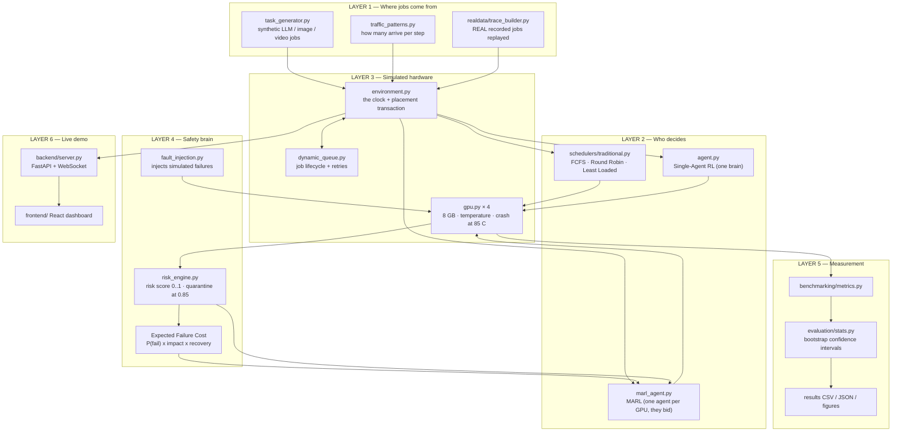
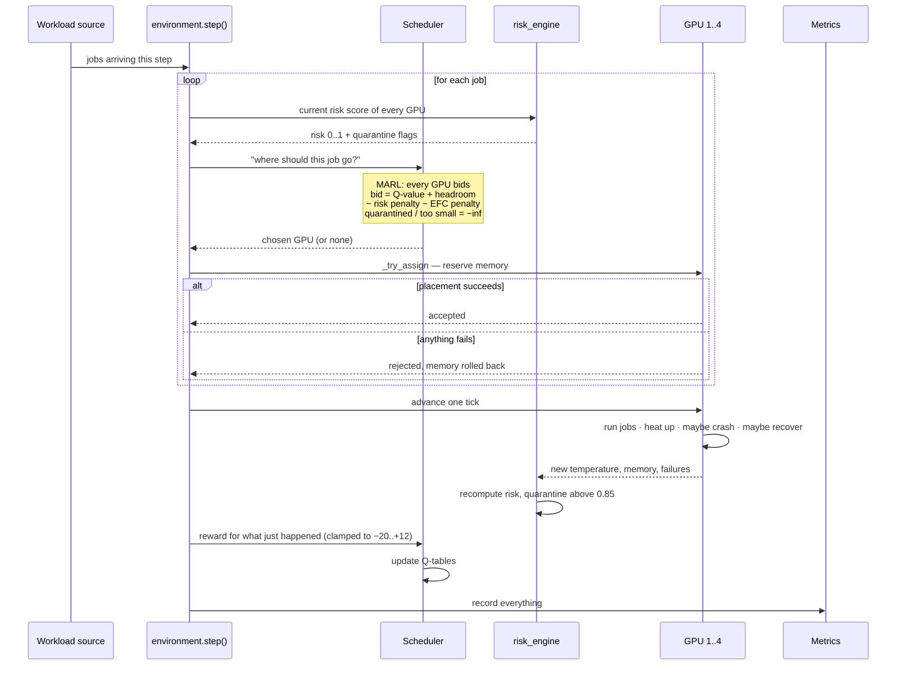

# 03 — System Architecture

This document explains how the system is put together, in plain language. Every statement here was
checked against the source code.

---

## 1. The big idea in one picture

The system has four layers. Jobs come in at the top, a decision-maker picks a GPU, the simulated
hardware runs the job, and a measurement layer records what happened and feeds a reward back up to the
decision-maker so it can learn.

---

## 2. Component by component

### Layer 1 — Where the jobs come from

Two completely separate sources feed the same simulator:

- **Synthetic jobs** (`workload/task_generator.py`). The program invents jobs: an LLM job, an image
  job or a video job, each with a memory requirement, a runtime, a priority and a severity.
  `workload/traffic_patterns.py` controls the arrival rate — light, heavy, bursty, or a peak/off-peak
  daily cycle.
- **Real recorded jobs** (`realdata/trace_builder.py`). Instead of inventing, this replays genuine
  production records. Two public datasets are used:
  - **BurstGPT** — 1,429,737 real AI inference requests recorded over 61 days.
  - **UCI video transcoding** — 168,286 real video-encoding measurements.

  Real token counts and real memory readings are converted into simulator job sizes by
  **percentile mapping**: the smallest 5 % of real jobs become the smallest simulator jobs, the median
  becomes the median, and so on. This keeps the *ordering* and *shape* of the real distribution without
  pretending the simulator's 8 GB GPUs are the same hardware the data came from.

### Layer 2 — Who decides

Six schedulers, all behind one common interface (`benchmarking/scheduler_adapters.py`) so they can be
compared fairly:

| Scheduler | How it decides |
|---|---|
| **FCFS** | First job gets the first GPU that fits. No cleverness. |
| **Round Robin** | Take turns: GPU 1, 2, 3, 4, 1, 2… |
| **Least Loaded** | Pick whichever GPU currently has the most free memory. |
| **Single-Agent RL** | One Q-learning brain sees the whole cluster and picks a GPU. |
| **Risk-Blind MARL** | Each GPU has its own agent. They bid; the highest bid wins. Bids ignore risk. |
| **Risk-Aware MARL** | Same auction, but each bid is reduced by the GPU's risk score and by the Expected Failure Cost of putting *this specific job* on *this specific GPU*. Quarantined GPUs and GPUs without room bid −∞, so they can never win. |

**The auction, concretely** (`MARLManager.compute_bid_score_breakdown`): every GPU's agent produces a
score from its Q-table estimate, plus how much free headroom it has, minus a risk penalty, minus an
EFC penalty. The highest score takes the job.

### Layer 3 — The simulated hardware

- **`gpu.py`** — one simulated GPU: 8 GB memory, a temperature that climbs as jobs pile up, memory
  that becomes fragmented over time, a crash at 85 °C, and a cooldown period after a crash during
  which it accepts nothing.
- **`environment.py`** — the clock. Each step it collects arrivals, asks the scheduler where each job
  goes, places it, advances all four GPUs, updates risk, pays out rewards, and records statistics.
- **`dynamic_queue.py`** — tracks every job through QUEUED → SCHEDULED → RUNNING → COMPLETED / FAILED /
  CANCELLED, and handles retries.

### Layer 4 — The safety brain

- **`risk_engine.py`** blends eight signals into one risk score between 0 and 1. The biggest weights go
  to things that have actually gone wrong before — past anomalies (0.25) and past task failures (0.20)
  — rather than to instantaneous readings. A GPU above **0.85** is quarantined.
- **`fault_injection.py`** deliberately causes failures so the schedulers can be tested against them.
- **Expected Failure Cost** is the forward-looking part. Risk score says "this GPU looks dangerous";
  EFC says "and putting *this* job there would cost *this much* if it goes wrong".

### Layer 5 — Measurement

- `benchmarking/metrics.py` computes throughput, utilisation, load balance, Jain's fairness index,
  risk exposure and EFC.
- `evaluation/stats.py` provides **bootstrap confidence intervals** and **paired win rates**. This is
  the part that turns "MARL looked better once" into "MARL is or is not reliably better".
- `realdata/PREREGISTRATION.md` fixes the hypotheses and the pass/fail rules *before* the experiment.

### Layer 6 — The live demo

A FastAPI server streams the cluster state over a WebSocket to a React dashboard, which shows the four
GPUs, each MARL bidding decision, the risk heat map, the job graph and the benchmark panel. You can
upload a real video file and the server will analyse it with OpenCV and turn it into real jobs.

---

## 3. How data flows, step by step

---

## 4. Why the design was made this way

These are the reasons that can be read directly out of the code and its comments.

**One agent per GPU instead of one central brain.**
A single brain must learn a decision over the whole cluster, so its table of situations grows
explosively with the number of GPUs. Per-GPU agents each learn a much smaller problem — "should *I*
take this job?" — and a bidding auction combines their answers. The measured results make the trade-off
visible: in the real-data benchmark the single central brain became extremely cautious and completed
only about a third as many jobs as everything else.

**A 16-element discrete state, not raw numbers.**
`MARLAgent.get_state()` puts memory pressure, load, temperature, risk, failure rate, status and job size
into discrete buckets. Classic Q-learning needs a finite list of situations; bucketing keeps the table
small enough to actually fill in during a short run.

**Reward clamped to [−20, +12].**
Without a clamp, one catastrophic step can produce a reward so large and negative that it wipes out
everything the agent has learned. The measured learning curve
(`results/graphs/08_marl_learning_curve.png`) shows this failure mode happening when agents start
untrained: cumulative reward runs to −188,000 and the success rate collapses.

**Risk and EFC as *penalties on a bid*, not as hard rules.**
A hard rule ("never use a GPU above risk 0.6") would waste capacity. A penalty lets a risky GPU still
win when it is genuinely the best remaining option. Only two things are absolute: quarantine, and not
enough memory. Those bid −∞.

**Transactional placement with rollback.**
`_try_assign()` reserves memory, registers the job and schedules it. If any part fails, everything is
undone. Without this, a half-finished placement would leak memory that is never released.

**Reentrant locks and a fixed lock order.**
The simulator, the web server and the test suite all touch the same state from several threads.
Reentrant locks (`threading.RLock`) are used because the code frequently calls one locked method from
inside another on the same thread; a plain lock would freeze. A fixed acquisition order
(`_step_lock → task_queue._lock → gpu._lock → _stats_lock`) prevents two threads from deadlocking by
grabbing the same two locks in opposite orders.

**Percentile mapping for real data, not a linear scale.**
Real prompt sizes span several orders of magnitude. Multiplying them by a constant would make almost
every job either trivially small or impossibly large. Percentile mapping preserves which jobs are
bigger than which, which is what a scheduler actually reacts to.

**TRAIN and EVAL windows that never overlap.**
Days 0–30 of the real trace are used to train the learning agents; days 31–61 are used to test them,
with exploration switched off (`set_eval_mode()`, ε = 0). Without this split, a learning scheduler would
be tested on data it had memorised and would look artificially good.

**Pre-registration.**
The hypotheses and the decision rules were written down before the results existed. That is why the
project is able to report that its own main hypotheses were *not* supported, instead of quietly
reframing the result.

---

## 5. Diagram image

A rendered copy of the architecture diagram is saved at
`results/graphs/00_architecture.png` for use in slides.
