# 06 — Graph Explanations

Every figure in `results/graphs/`, explained in plain language. All were generated on
**30 October 2026** from the runs recorded in `logs/`.

**Figures 01–04** are produced by the project's own script, `realdata/generate_visualizations.py`.
**Figure 00 and figures 05–11** were generated during this documentation pass by
`results/make_architecture_diagram.py` and `results/make_graphs.py`, which only read result files the
project had already written.

---

## 00_architecture.png — System architecture

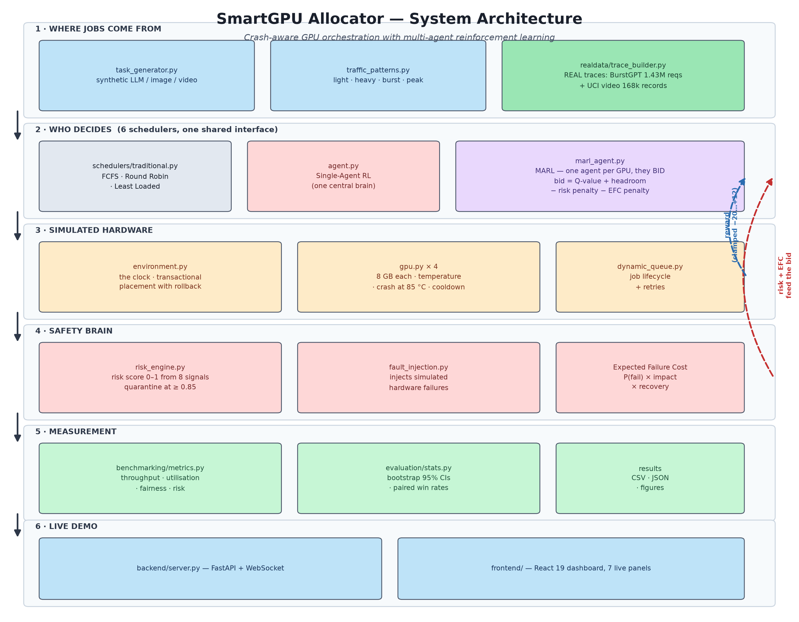

**What it shows.** Not data — a structural map of the software, in six stacked bands.
Band 1 (top) is where jobs come from: either a synthetic generator or a replay of real production
traces. Band 2 is the six schedulers. Band 3 is the simulated hardware: the clock, four 8 GB GPUs and
the job queue. Band 4 is the safety machinery: the risk engine, the fault injector and the Expected
Failure Cost model. Band 5 is measurement. Band 6 is the live web dashboard.

The solid black arrows down the left show the normal flow of a job. The two **dashed arrows on the
right** are the feedback loops that make this reinforcement learning rather than a fixed rule: risk and
EFC flow back up into the bidding, and the reward (clamped to −20…+12) flows back into the Q-tables.

**Key takeaway.** The system is a closed loop — decisions change the hardware state, the hardware state
changes the risk score, and the risk score changes the next decision.

**Relation to the objective.** It shows that crash-awareness is wired into the decision itself, not
bolted on as a filter afterwards.

---

## 01_risk_vs_throughput.png — Safety vs throughput (project's own figure)

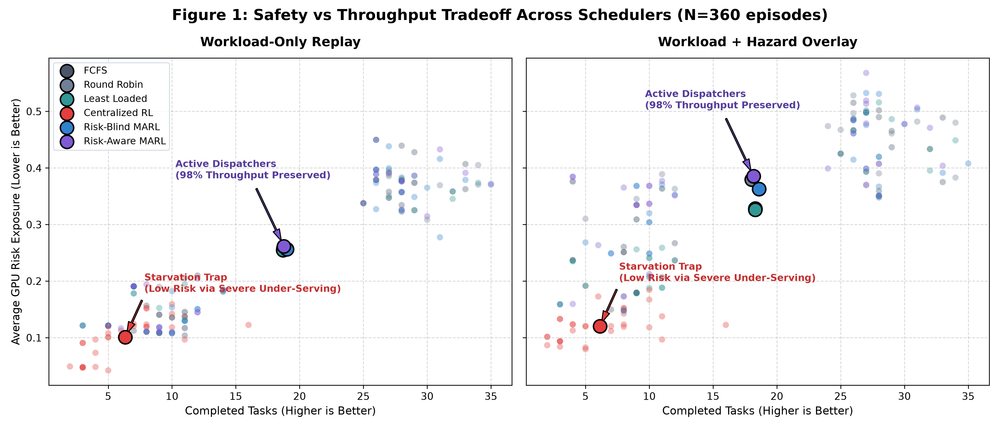

**What it shows.** Two panels: workload-only replay on the left, with the real hazard overlay on the
right. Every faint dot is **one of the 360 individual episodes**; the large outlined circles are the
per-scheduler averages. Colour = scheduler. The x-axis is tasks completed (**right is better**), the
y-axis is average risk exposure (**lower is better**). The ideal position is bottom-right.

**What the numbers tell us.** The faint cloud reveals real spread — individual episodes range from
about 2 to 35 completed tasks, because the three load levels and two time windows are genuinely
different operating conditions. The red cloud (Centralized RL) sits distinctly to the left: it is
low-risk but also low-throughput in nearly every single episode, not just on average. The annotation
labels this the **"Starvation Trap"**.

**Key takeaway.** Centralized RL buys its low risk by under-serving the cluster, while the active
dispatchers preserve ~98 % of throughput at a higher but similar risk level.

**Relation to the objective.** It challenges the simple framing of the objective: "lower risk" is only
meaningful alongside "same amount of work done".

---

## 02_metrics_comparison.png — All four metrics with confidence intervals (project's own figure)

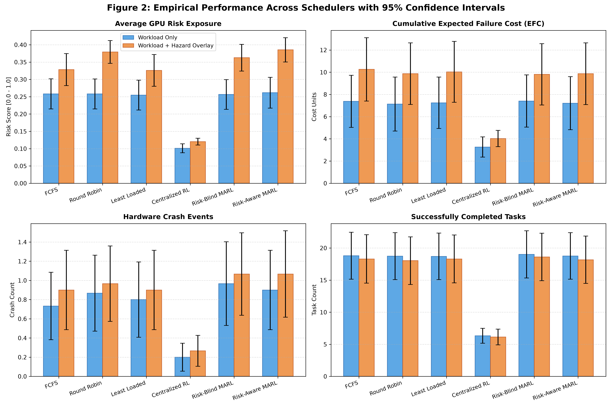

**What it shows.** Four panels, one per pre-registered metric: risk exposure, cumulative Expected
Failure Cost, hardware crash events, and completed tasks. In each, six schedulers are shown as pairs
of bars — **blue = workload replay only, orange = with the real hazard overlay applied**. The black
whiskers are 95 % confidence intervals.

**What the numbers tell us.** Three things.
1. **The overlay works.** Orange is consistently taller than blue in the risk, EFC and crash panels —
   applying real-world failure probabilities genuinely makes the cluster more dangerous.
2. **Centralized RL is the outlier everywhere.** Its bars are dramatically lower in the first three
   panels, and dramatically lower in the fourth too (~6 tasks vs ~18–19).
3. **The other five are indistinguishable.** Their confidence intervals overlap heavily in every panel.

**Key takeaway.** Among schedulers that actually dispatch work, no scheduler is reliably safer than
any other — the error bars swamp the differences.

**Relation to the objective.** This is the figure that most directly shows the main hypothesis was not
supported: the purple Risk-Aware MARL bars are not lower than the grey traditional ones.

---

## 03_hazard_curves.png — Real-world failure rate vs burstiness (project's own figure)

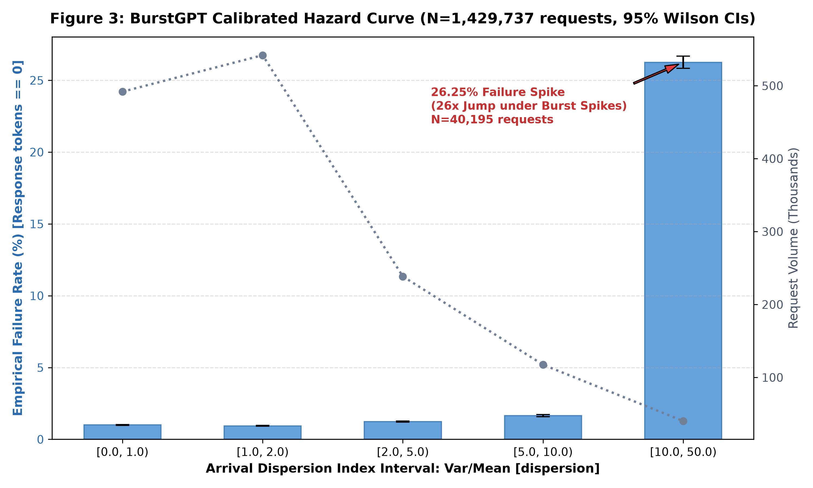

**What it shows.** Measured from **1,429,737 real BurstGPT requests**. The x-axis groups traffic by
**dispersion index** (variance ÷ mean arrival rate) — low means requests arrive smoothly, high means
they arrive in violent clumps. **Blue bars** = the measured failure rate in each band (left axis, %).
The **grey dotted line** = how many requests fell in each band (right axis, thousands) — it is a sample-
size indicator, not a trend. Tiny black whiskers are 95 % Wilson confidence intervals.

**What the numbers tell us.** The failure rate is essentially flat at about **1 %** across the first
four bands (1.00 %, 0.94 %, 1.23 %, 1.65 %), then jumps to **26.25 %** in the most bursty band — a
**26-fold increase**. The confidence interval there is [25.82 %, 26.68 %], extremely tight because
40,195 requests fall in that band. The dotted line shows the extreme band is the *rarest*, which is why
it is easy to miss in an average.

**Key takeaway.** Burstiness is not a minor nuisance — it is the single dominant driver of real-world
request failure.

**Relation to the objective.** This strongly supports the project's *premise*. It proves that GPU
workload risk is real, measurable and concentrated, which justifies building a risk-aware scheduler
even though that scheduler did not end up outperforming the baselines.

---

## 04_load_sensitivity.png — Behaviour as load increases (project's own figure)

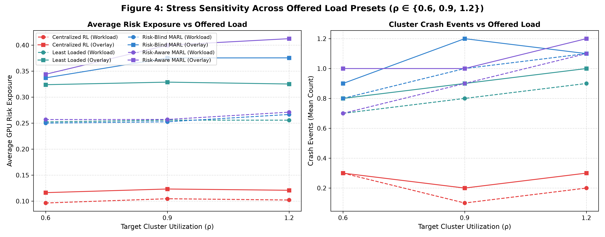

**What it shows.** Two line charts against **target cluster utilisation ρ** = 0.6, 0.9 and 1.2 (that
last one is deliberate overload). Left panel: average risk exposure. Right panel: crash events.
Colour = scheduler; **dotted lines = workload only, solid lines = with hazard overlay**.

**What the numbers tell us.** In the left panel the lines are remarkably **flat** — risk barely changes
as offered load rises from 60 % to 120 % of capacity. Risk-Aware MARL (purple, solid) is the one
exception, rising from 0.343 to 0.412. The red Centralized RL lines sit far below everything else and
stay flat, because it is not dispatching regardless of how much work arrives. The right panel shows
crashes generally *increasing* with load, as expected, and all the active schedulers converging around
1.0–1.2 crashes at ρ = 1.2.

**Key takeaway.** No scheduler's advantage depends on a particular load level — the comparison is
robust, and Risk-Aware MARL is not fragile even though it is not better.

**Relation to the objective.** It rules out the objection that the parity finding is an artefact of
one convenient operating point.

---

## 05_six_scheduler_synthetic_benchmark.png — Synthetic benchmark

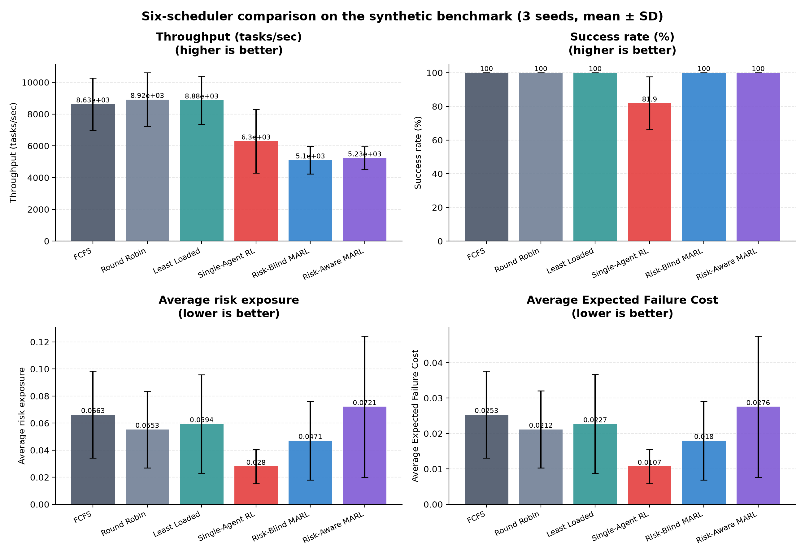

**What it shows.** Four bar panels across six schedulers (3 seeds each, identical task streams), with
standard-deviation whiskers: throughput, success rate, average risk exposure, average EFC. The label
above each bar is its mean.

**What the numbers tell us.** Success rate is **100 % for five of six schedulers**; only Single-Agent
RL drops, to **81.9 %**, with a very wide error bar — it is both worse and less consistent. In the risk
panel, Risk-Aware MARL records the **highest** mean (0.0721) with a very wide spread, while Risk-Blind
MARL records 0.0471.

> **Read the throughput panel with care.** That number is completed tasks divided by **wall-clock CPU
> seconds** (episodes finish in roughly 5 milliseconds), so it measures **how expensive the scheduler's
> own decision-making is** — not how much work the cluster did. MARL appears slower (≈5,200 vs ≈8,900)
> purely because it runs a four-agent bidding auction for every task. On real hardware, where a task
> takes seconds, that overhead would be irrelevant. **Do not present this as cluster throughput.**

**Key takeaway.** On synthetic workloads all schedulers complete their work; the learned ones cost more
compute and do not buy lower risk.

**Relation to the objective.** It challenges the objective — Risk-Aware MARL scored the highest risk of
all six here.

---

## 06_ablation_risk_components.png — Which part of the design does the work?

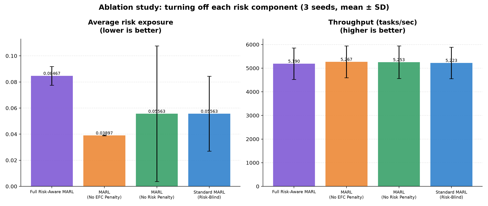

**What it shows.** An **ablation study** — removing one piece at a time to see what each contributes.
Four variants: the full Risk-Aware MARL, the same with the risk penalty removed, the same with the EFC
penalty removed, and standard risk-blind MARL. Left panel = average risk exposure (lower better),
right panel = throughput.

**What the numbers tell us.** The result is **the opposite of what was expected**. The full risk-aware
model recorded the **highest** risk (0.0847). Removing the EFC penalty gave the **lowest** (0.0390).
Removing the risk penalty gave 0.0556 — identical to plain risk-blind MARL (0.0556), which makes sense
because that variant is effectively the same algorithm. Throughput is essentially flat across all four
(5,190–5,267), so none of this is a throughput trade-off.

**Key takeaway.** The safety penalties did not reduce measured risk — they increased it.

**Relation to the objective.** This directly challenges the objective. One plausible explanation is
that the penalties push work off whichever GPU is currently loaded and spread it across all four,
raising the *average* risk even while lowering the peak on any one GPU. **That explanation was not
tested** — it is stated as interpretation, not as a finding.

---

## 07_seven_scenario_completion_rate.png — Seven stress scenarios

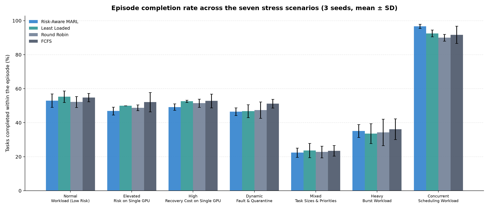

**What it shows.** Grouped bars: seven deliberately hostile scenarios along the x-axis, four schedulers
per group (blue = Risk-Aware MARL, teal = Least Loaded, light grey = Round Robin, dark grey = FCFS),
3 seeds each with standard-deviation whiskers. The y-axis is the percentage of tasks completed within
the episode.

**What the numbers tell us.** In **six of the seven** scenarios the four bars are nearly level and
their error bars overlap substantially — statistically a tie. MARL is in fact slightly *behind* in
scenarios 1–5. Scenario 5 (mixed task sizes) is hardest for everyone, dropping all four to ~22–24 %.
The exception is the last group, **concurrent scheduling**, where MARL reaches **96.7 %** against
90.0–92.5 %, and with a visibly tighter error bar.

**Key takeaway.** Risk-Aware MARL's advantage is real but narrow — it appears only when many tasks
arrive simultaneously from multiple threads.

**Relation to the objective.** Partially supports it. The per-GPU bidding auction does resolve
simultaneous contention better than a single global rule, which is exactly the situation a multi-agent
design should be good at.

---

## 08_marl_learning_curve.png — Learning from scratch does not converge

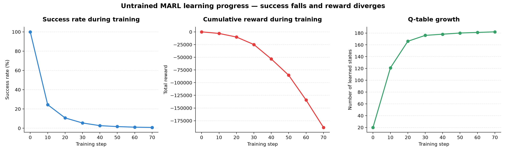

**What it shows.** Three line charts tracking MARL during training from a completely untrained start:
success rate (%), cumulative reward, and Q-table size (how many distinct situations the agents have
learned about), all against training step.

**What the numbers tell us.** The success rate **collapses** from 100 % at step 0 to **0.80 %** by step
70. The cumulative reward does not merely decline — it **diverges**, reaching about **−188,000**. The
Q-table grows quickly at first and then **flattens at around 182 states**, meaning the agents are
revisiting the same situations repeatedly and still failing in them. The starting 100 % is misleading:
at step 0 only a handful of tasks have been attempted.

**Key takeaway.** Seventy steps is nowhere near enough to learn a four-way placement problem; untrained
MARL actively gets worse.

**Relation to the objective.** It challenges the repository's claim of a "36 % learning improvement" —
the script that produced this data prints *"MARL Learning Improvement: NO"*. It also **justifies a
design decision**: the serious real-data benchmark trains on 30 days of real traffic first, then
freezes the Q-tables and switches exploration off before testing.

---

## 09_realdata_risk_vs_throughput.png — The starvation trap, averages only

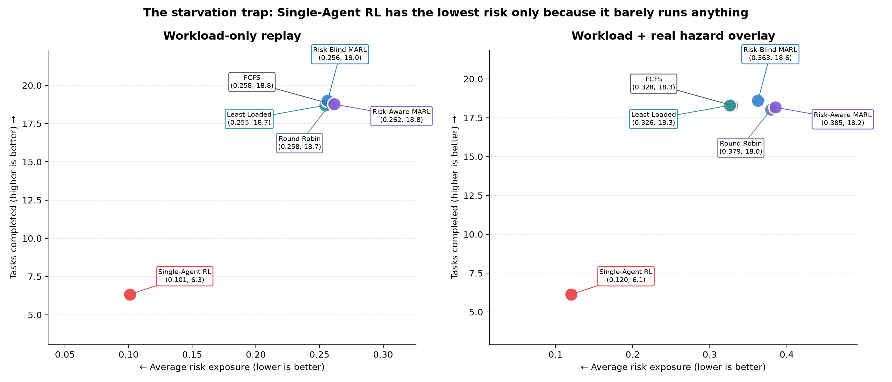

**What it shows.** A cleaner, labelled version of figure 01 showing only the six scheduler averages,
with exact coordinates printed in each label. Left panel = workload replay, right = with hazard
overlay. **Left is safer; higher means more work done.**

**What the numbers tell us.** Five schedulers cluster tightly in the upper right — workload replay
spans risk 0.255–0.262 and 18.7–19.0 tasks. Single-Agent RL sits alone at **(0.101, 6.3)**: less than
half the risk, but **a third of the work**. The same pattern repeats under the overlay, where the five
active schedulers span 0.327–0.385 risk at 18.0–18.6 tasks while RL sits at **(0.121, 6.1)**.

**Key takeaway.** The lowest-risk scheduler is the one that barely schedules anything.

**Relation to the objective.** This is the single figure that explains *why* the pre-registered
hypotheses were rejected. Because the pre-registration picks the strongest baseline **per metric
independently**, this starving scheduler became the yardstick for risk, EFC and crashes — a yardstick
Risk-Aware MARL could not beat without also refusing to work.

---

## 10_realdata_four_metrics.png — All four metrics, both regimes

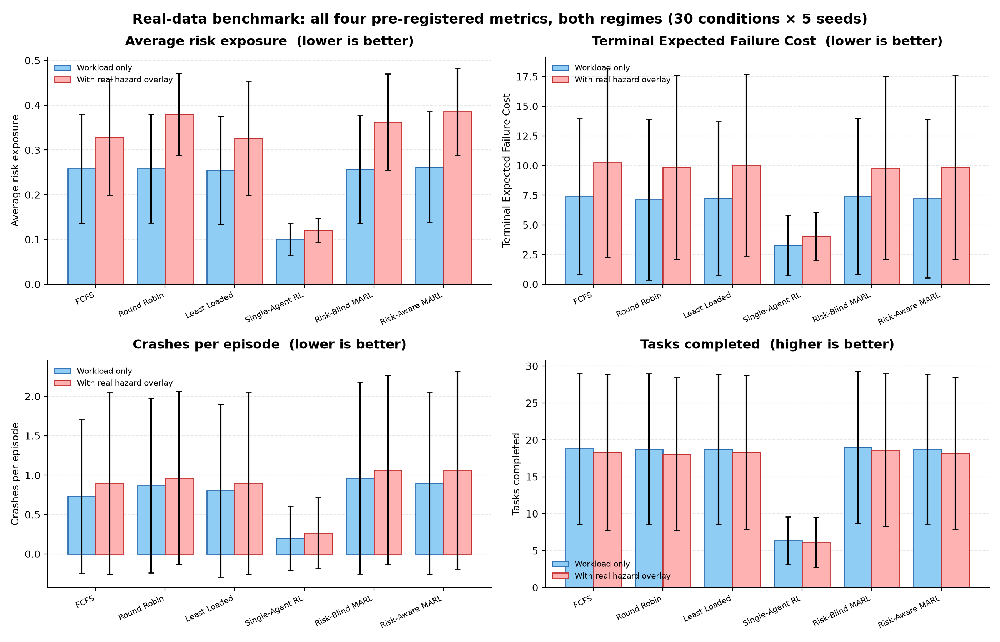

**What it shows.** Four panels, one per pre-registered metric, six schedulers each, with paired bars:
**light blue = workload replay only, light red = with the real hazard overlay**. Whiskers are standard
deviations across the 30 conditions.

**What the numbers tell us.** The red bars sit above the blue in the risk, EFC and crash panels for
every scheduler — the overlay makes things measurably worse, confirming it is doing something real.
In the completed-tasks panel red is slightly *lower* than blue, because failures destroy work. The
error bars are large throughout, because three load levels and two time windows are pooled into each
average. Crucially, **the ordering of the schedulers is the same in both regimes**.

**Key takeaway.** Harsher, more realistic conditions raise everyone's risk without changing who is
ahead of whom.

**Relation to the objective.** A robustness result. The parity finding is not an artefact of the
gentler regime — it holds when realistic failure rates are applied.

---

## 11_preregistered_hypothesis_tests.png — The formal verdict

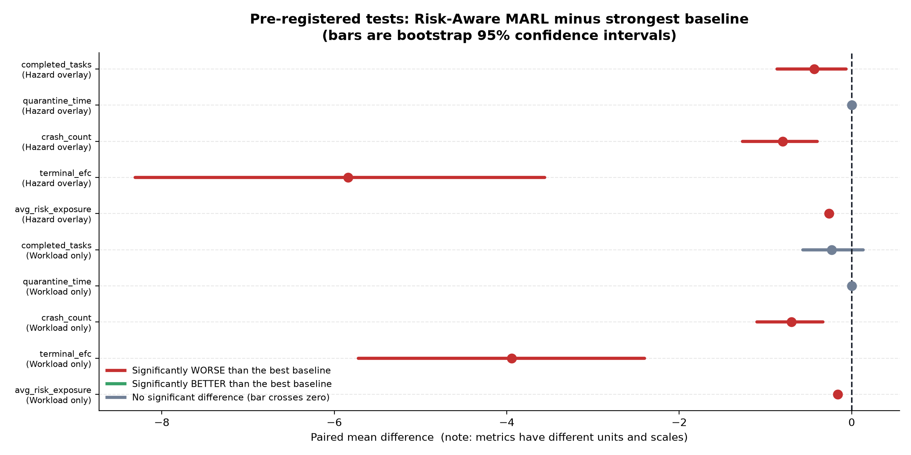

**What it shows.** A confidence-interval plot. Each horizontal bar is the **bootstrap 95 % confidence
interval** for *Risk-Aware MARL minus the strongest baseline* on one metric, in one regime. The dot is
the mean difference. The dashed vertical line is zero — no difference. **Red = significantly worse,
grey = no significant difference**, as the legend states. Note the metrics have **different units and
scales**, so bar lengths are not comparable to each other.

**What the numbers tell us.** Six red bars sit entirely to the left of zero: risk exposure, EFC and
crash count, in both regimes. Risk-Aware MARL is significantly *worse* than the strongest baseline on
all three. Four grey bars cross or touch zero: quarantine time (every scheduler scored exactly 0.00, so
there is nothing to separate) and completed tasks (a statistical tie in workload replay).

**Key takeaway.** Against the pre-registered rule — CI excluding zero favourably **and** ≥ 60 % win
rate — hypotheses **H1, H2 and H3 are rejected**, H4 is inconclusive, H5 is partially supported.

**Relation to the objective.** It is the honest answer to the objective: **not achieved** as a research
claim. The important caveat is that the comparison is against the *starving* RL scheduler; measured
against the schedulers that actually do the work, the result is a tie rather than a loss. Reporting
this openly, against rules fixed before the data existed, is what makes the rest of the project's
claims credible.

---

## Summary: what the figures collectively say

| Question | Answer from the figures |
|---|---|
| Is GPU workload risk real and measurable? | **Yes** — fig 03, a 26× failure jump in real data |
| Does the system run correctly? | **Yes** — fig 05, 100 % success for 5 of 6 schedulers; 0 capacity violations |
| Is Risk-Aware MARL safer than the baselines? | **No** — figs 02, 10, 11 |
| Is it at least as productive? | **Yes** — ~98 % of risk-blind MARL's throughput (figs 09, 10) |
| Does it ever win? | **Yes, once** — concurrent arrivals, 96.7 % vs 90–92.5 % (fig 07) |
| Do the safety penalties help? | **No** — removing them lowered measured risk (fig 06) |
| Does MARL learn from scratch? | **No** — reward diverges to −188,000 (fig 08) |
| Are the conclusions robust? | **Yes** — hold across load levels and both regimes (figs 04, 10) |

---

# Part II — v2 figures (`results/graphs/v2/`)

These thirteen figures belong to the v2 investigation. The six `v2_01`–`v2_06` figures come from the
Phase 1 diagnosis; `v2_07`–`v2_13` come from the final test. **The v1 figures above are unchanged.**

---

## v2_01_choice_availability.png — The binding constraint

**What it shows.** How many GPUs were actually eligible to receive a task at each scheduling decision
in v1.

**What to look for.** The histogram is almost entirely at **zero eligible GPUs** — 99.28 % of 65,271
decisions. The right panel shows the same thing as a share of offered tasks admitted: **1.19 %**.

**Why it matters.** A scheduler can only differ from another scheduler when it has a choice. With no
eligible GPU, FCFS, Round Robin and Risk-Aware MARL all do exactly the same thing: nothing. This one
figure explains v1's "parity" result.

---

## v2_02_bid_term_magnitudes.png — The risk penalties were never the problem

**What it shows.** The size of each term in the MARL bid, and how often the risk terms change which
GPU wins.

**What to look for.** The risk and EFC penalties move the bid outcome on **37.74 %** of decisions, and
the penalty spread is **0.85×** the reward spread — comparable, not negligible.

**Why it matters.** This is the evidence that killed candidate improvement A ("make the penalties
stronger"). The penalties already had real influence. Strengthening them would have been tuning a
part that was not broken.

---

## v2_03_ablation_peak_vs_mean.png — v1's ablation surprise was noise

**What it shows.** The v1 ablation (full / no-EFC / no-risk / risk-blind) re-run with more seeds, and
measured on both mean and peak risk.

**What to look for.** The four variants sit within **1–6 % of a single standard deviation** of one
another. The dramatic "removing the penalties made it safer" reversal in v1 §6.3 does not reappear.

**Why it matters.** v1's ablation used 3 seeds. This figure shows that result was a sampling artefact,
not a finding — and corrects it in the honest direction (there was no real reversal to explain).

---

## v2_04_quarantine_reachability.png — The safety valve cannot be reached

**What it shows.** The maximum GPU risk score ever observed, against the quarantine threshold of 0.85.

**What to look for.** Even at 1,000 steps and ρ = 2.0, risk peaks at **0.72**. The threshold line is
never crossed.

**Why it matters.** Quarantine is a headline feature of the design, and it is **structurally dead** in
this simulator. Hypothesis H4 is not "unsupported" — it is **untestable**, and this figure is why.

---

## v2_05_starvation_mechanism.png — How a safety metric can be gamed

**What it shows.** Temperature traces and completion counts for a scheduler that simply refuses work.

**What to look for.** Idle GPUs stay cool, so the "risk" score looks excellent while almost nothing is
accomplished.

**Why it matters.** This is the starvation trap made visible, and it is the justification for the
pre-registered **throughput floor** used in v2 — a guard v1 did not have.

---

## v2_06_training_adequacy.png — The agents were barely trained

**What it shows.** Exploration rate and Q-table coverage after v1's training budget.

**What to look for.** ε is still **0.852** (i.e. ~85 % of actions are random), and the agent has
visited **49 of 57,395,628** possible states — **0.00009 %**.

**Why it matters.** v1 was, in effect, comparing a random dispatcher against FCFS and calling it
"MARL". The v2 training budget is larger — and, critically, **identical for all three learners**.

---

## v2_07_load_fix_validity.png — Why v1 could not answer the question, and v2 can

**What it shows.** *Left:* intended vs delivered utilisation (log scale) under each condition.
*Right:* the percentage of scheduling decisions that were genuinely contested.

**What to look for.** The red v1 bars sit far above the dashed "intended" line — **7.98** delivered
where **1.1** was asked for. The teal and purple bars land on the line. On the right, v1's contested
rate collapses to **0.11 %** at ρ = 1.1 while v2 holds at **21.96 %**.

**Why it matters.** This is the figure that licenses everything else in v2. It demonstrates that the
re-test contains real decisions, which v1's did not. Without this, no v2 result would mean anything.

---

## v2_08_primary_hypothesis.png — The formal v2 verdict

**What it shows.** *Left:* the pre-registered primary metric (risk per completed task) for all six
schedulers at ρ = 1.1. *Right:* the paired per-episode difference between Risk-Aware MARL and the
strongest eligible baseline, sorted.

**What to look for.** Risk-Aware MARL's bar is the **tallest** (worst) among feasible schedulers. On
the right, the bars are overwhelmingly **red and above zero** — Risk-Aware MARL is worse in
**54 of 60** paired episodes. The pre-registered threshold was 36 of 60.

Single-Agent RL's bar is **hatched**: it scores best but completes only 108.5 tasks against 151.3,
below the 80 % throughput floor, so it is **INFEASIBLE** and excluded from baseline selection.

**Why it matters.** This is the single confirmatory test in the whole v2 programme, fixed in advance.
It is **rejected**, and not narrowly — the 95 % CI excludes zero in the *wrong* direction.

---

## v2_09_mean_vs_peak.png — The most important figure in v2

**What it shows.** The same six schedulers measured three ways: mean risk across GPUs, peak risk on
the hottest GPU, and crashes.

**What to look for.** Risk-Aware MARL is **worst on mean risk** (0.1916) and simultaneously **best on
peak risk** (0.5217). Those are not contradictory — they are the same behaviour seen from two angles.

**Why it matters.** It explains the rejection mechanically. The risk-aware bidder **spreads** work, so
all four GPUs run moderately warm. FCFS **concentrates** work, so some GPUs are cold and others
overheat. The *average* prefers "two cold, two burning"; the *peak* prefers "four warm". Only one of
those two arrangements actually destroys hardware.

The honest reading: **the pre-registered primary metric rewards the failure mode the system was
designed to prevent.** That is reported as a finding, not used as grounds to change the metric after
the fact.

---

## v2_10_pareto.png — Throughput against risk, all three loads

**What it shows.** Each scheduler as a point: completed tasks (right = better) against mean risk
(down = better), at ρ = 0.3, 1.1 and 1.4.

**What to look for.** The five dispatchers cluster tightly on the right at every load — they complete
near-identical work. Single-Agent RL sits far to the **left**: low risk bought by doing less. Risk-Aware
MARL sits at the **top** of the dispatcher cluster.

**Why it matters.** It shows the trade-off is real but small among schedulers that actually work, and
it shows visually why the throughput floor is necessary: without it, the point furthest down-left
"wins" by refusing to schedule.

---

## v2_11_v1_vs_v2.png — Risk-Aware MARL under each condition

**What it shows.** Four metrics for Risk-Aware MARL only, under v1, v1+load-fix, and v2.

**What to look for.** Two things, both easy to misread:

1. v1 completes **302** tasks vs 128. This is **not** a better result — v1 was offered ~7× more work
   than intended. Crashes fell from 27.7 to 5.81 for the same reason.
2. **v1+load-fix and v2 are nearly identical** (0.164 vs 0.163 mean risk; 5.90 vs 5.81 crashes).

**Why it matters.** Point 2 is the honest headline: **almost the entire v2 change comes from the load
fix alone.** The TRAIN-derived risk buckets and the larger training budget moved the numbers by well
under 1 % — matching the tuning result, where 20 configurations produced only 4 distinct scores.

---

## v2_12_quarantine.png — The shipped safety valve never fires

**What it shows.** How often quarantine triggered, at the shipped threshold (0.85) and an exploratory
one (0.60), in both regimes.

**What to look for.** Every 0.85 bar is labelled **0**. The shipped threshold fired in **0 of 3,240
episodes** in the workload regime and **0 of 3,240** under the hazard overlay. The 0.60 threshold
fires often — 47.3 % and 68.3 % of episodes respectively.

**Why it matters.** It confirms the diagnosis on test data: H4 is **untestable**, not unsupported. The
0.60 results are shown because the pre-registration requires reporting them, but they are exploratory
— lowering a shipped threshold until it passes its own test would not be evidence.

---

## v2_13_overlay_effect.png — The hazard overlay raises risk for everyone

**What it shows.** Crashes and mean risk with the workload only, versus with the real-data hazard
overlay applied, at ρ = 1.1.

**What to look for.** Every orange bar is higher than its teal partner — FCFS crashes rise from 8.2 to
14.0. The **ordering between schedulers barely changes**.

**Why it matters.** It confirms the overlay is doing real work (this is also the bug that was caught
pre-flight — see `CHANGES_MADE.md`, where a defaulted `enabled=False` would have silently made this
entire regime a duplicate of the workload-only one). And it shows the v2 conclusions are not an
artefact of one failure regime.

---

## Summary: what the v2 figures collectively say

| Question | Answer from the v2 figures |
|---|---|
| Did v1 test its own hypothesis? | **No** — fig v2_01, 99.28 % of decisions had no choice |
| Were the risk penalties too weak? | **No** — fig v2_02, they move 37.74 % of decisions |
| Was v1's ablation reversal real? | **No** — fig v2_03, it was a 3-seed artefact |
| Can quarantine ever trigger? | **No** — figs v2_04 and v2_12, 0 of 3,240 episodes |
| Is the v2 experiment valid? | **Yes** — fig v2_07, ~22 % of decisions are contested |
| Is Risk-Aware MARL safer on the primary metric? | **No — significantly worse** (fig v2_08) |
| Is it safer on *peak* risk? | **Yes**, and best of all six (fig v2_09, exploratory) |
| Does it cost throughput? | **No** — 99.98 % of the best scheduler (figs v2_09, v2_10) |
| Which fix actually mattered? | **The load fix, almost entirely** (fig v2_11) |
| Do the conclusions hold under real hazards? | **Yes** — fig v2_13 |
